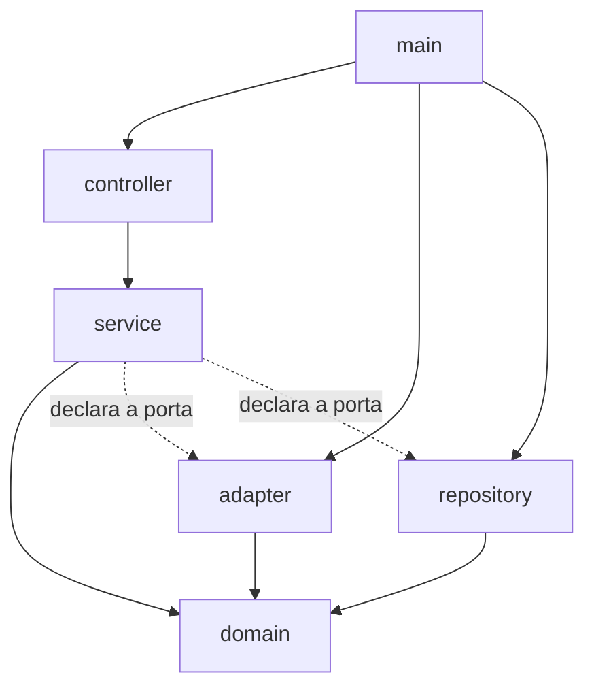
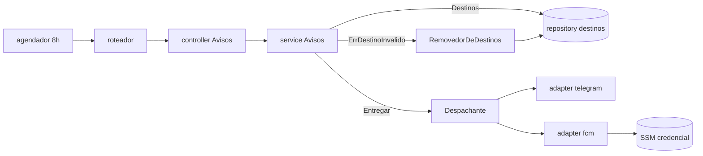

# Architecture Spine: Canais de aviso do financas-ai

Spine do metodo-ai, revisada por dois revisores independentes e aprovada pelo dono em 2026-11-14. Onde divergir de `arquitetura.md` ou `guardrails.md`, a divergência vai ao dono antes de qualquer código.

## Design Paradigm

Portas e adaptadores. O `service` declara as portas (`service.Canal`, `LeitorContatos`, `RemovedorDeDestinos`); cada canal é um adaptador em `adapter/notificacao/`; o `main` registra os canais. **Canal é vocabulário da API e da infraestrutura, não da regra de negócio.**

| Camada | Pasta | Pode nomear um canal? |
| --- | --- | --- |
| entrada | `main.go`, `servidor.go` | Sim: registra os adaptadores |
| controller | `controller/` | Sim: o contrato da API nomeia (`{"canal":"push"}`, `telegramChatId`); traduz erro de canal em frase |
| service | `service/` | Não, exceto `aparelhos.go` (AD-5), que é do push por natureza |
| domain | `domain/` | Não, exceto `espaco.go` e `perfil.go` (AD-9) |
| adapter | `adapter/notificacao/` | Sim: formato, limite, transporte, credencial |
| repository | `repository/` | Sim: único mapa campo do vínculo ↔ canal (AD-4) |

## Inherited Invariants

| Inherited | From parent | Binds here |
| --- | --- | --- |
| Dependência só para dentro; o service declara as interfaces | `arquitetura.md`, "Camadas" | Toda porta nova é declarada no service |
| Dependências por construtor, sem global | `arquitetura.md`, "Camadas" | AD-6 |
| Canal novo é um adaptador novo registrado no `main` | `arquitetura.md`, "Avisos: um despachante" | Falso hoje para o push; AD-1 a AD-3 o tornam verdadeiro |
| O limite de 4096 do Telegram é problema do adaptador | `arquitetura.md`, "Avisos: um despachante" | AD-1 |
| Nenhuma chave ou campo novo no DynamoDB sem o dono | `arquitetura.md`, princípio 3 | `pushTokens` já aprovado (2026-11-13); nada além |
| O front não decide quem recebe nem o que dizer | `guardrails.md` | AD-7 |

## Invariants & Rules



### AD-1 — Texto, limite e transporte do canal moram no adaptador

- **Binds:** `domain/aviso_resumo.go`, `adapter/notificacao/*`, R7, R9, R18.
- **Prevents:** formato de um canal em `domain` (hoje `LimiteTelegram`, `PartesDoResumo`, `MontarResumo`, `Texto()` e `TextoDeTeste`, todos no formato do Telegram) e o push repetindo o erro com `TextoDoPush`.
- **Rule:** `domain` guarda só o que é regra: `ResumoAvisos`, `LinhaAviso`, ordem, agrupamento e `Contagens` (AD-3). Montar texto, dividir em partes e o limite de 4000 letras vão para `adapter/notificacao/telegram.go`; o texto do push é montado em `fcm.go`. **Custo do PR 0:** movem-se junto `domain/aviso_resumo_test.go` inteiro e as partes de `service/despachante_test.go` e `service/avisos_test.go` que usam o canal falso com texto.

### AD-2 — O service trata o canal como valor opaco

- **Binds:** `service/avisos.go`, `service/despachante.go`, `controller/avisos.go`, `controller/resposta.go`, R13.
- **Prevents:** `ErrTelegramNaoConfigurado`, `ErrTelegramRecusou`, `todos["telegram"]` e `Destino{"telegram", …}` no service, que o push teria de copiar (R13 não fecha sem isto: `Testar` só entende Telegram).
- **Rule:**
  - `Testar(ctx, sid, sub, canal)` serve a qualquer canal. O controller lê `canal` do corpo e, ausente, passa o canal do Telegram (compatível com hoje: `TestMensagemDeTeste` sem mudar asserção). O service não escolhe padrão.
  - Canal que o despachante não conhece devolve `service.ErrCanalDesconhecido`, e o controller o traduz em `400` (R13; hoje cairia em `500`).
  - Erros que atravessam o service: `domain.ErrCanalNaoConfigurado` (503), `domain.ErrDestinoInvalido` (AD-4) e **`domain.ErrEntregaFalhou`** (502). O service embrulha em `ErrEntregaFalhou` qualquer outro erro do canal, como hoje faz com `ErrTelegramRecusou`; o adaptador não precisa tipá-lo.
  - Sem destino do canal pedido: `ErroValidacao` com texto sem o nome do canal; a frase que o cita vem do controller (`resposta.go`, tabela canal → frase).
  - `Testar` envia ao único endereço, se o canal tem um (Telegram), ou a **todos** os aparelhos da pessoa no espaço, se tem vários (push, R13).

### AD-3 — A regra "o push só conta" é do domain; o texto é do adaptador

- **Binds:** R18, P-T7, `fcm.go`.
- **Prevents:** duas versões da contagem; o adaptador do push ler descrição, valor ou meio de pagamento por conveniência.
- **Rule:** `domain.Contagens(ResumoAvisos)` devolve só inteiros (`Atrasados`, `Hoje`, `AVencer`) mais `Marca` e `Teste`, e é a função que `fcm.go` usa do resumo. Entradas contam na situação do vencimento. A garantia de R18 é o P-T7 (que passa a testar o `fcm.go`); um teste de arquitetura que proíbe `LinhaAviso` em `fcm.go` é reforço, não garantia, porque não pega `r.Linhas[i].Descricao`.

### AD-4 — Um dono para o mapa canal ↔ campo do vínculo

- **Binds:** R6, R10, R11, `repository/pessoas.go`, `service.Avisos`.
- **Prevents:** três lugares conhecendo `telegramChatId` e `pushTokens` (`Destinos`, o removedor e as gravações de aparelho), cada um com o seu mapa.
- **Rule:**
  - `repository/destinos.go` é o único lugar que liga canal a campo do vínculo, numa tabela só. `Destinos` (leitura), `RemoverDestino` e as gravações de `pushTokens` (AD-5) usam essa tabela.
  - Só `domain.ErrDestinoInvalido` apaga um destino. O adaptador decide quando o devolve (FCM: `404 UNREGISTERED`; Telegram: nunca, hoje).
  - Porta, declarada no service: `RemovedorDeDestinos.RemoverDestino(ctx, sid, sub, canal, endereco) error`.
  - **Emenda ao R12:** para R11, a rotina guarda, por `Destino`, a lista dos vínculos `(sid, sub)` de onde ele saiu. O agrupamento por destino não muda; a rotina passa a lembrar a origem.
- `ErrDestinoInvalido` e `RemoverDestino` **não existem** no código; nascem na fase 1 do push, não no PR 0.

### AD-5 — Aparelhos são um assunto próprio

- **Binds:** R2, R3, R4, R5, R22, rotas `/push`.
- **Prevents:** registrar, remover e sair espalhados em `Avisos` (que já faz rotina, teste e fatura) ou em `Perfil`.
- **Rule:** `service.Aparelhos` e `controller.Aparelhos`, um arquivo cada, com o `sub` sempre do JWT. Escrita de `pushTokens` só pelo `repository/destinos.go` (AD-4). Ações novas em `auth/authz.go`: `push.registrar`, `push.remover`, `push.sair`. O limite de 5 e a idempotência são condição da própria gravação (R4), sem leitura antes.

### AD-6 — Nenhum setter `Usar*` novo

- **Binds:** `servidor.go`, `service.NewAvisos`.
- **Prevents:** aumentar o ciclo `Lancamentos ↔ Cartoes ↔ Avisos ↔ Recorrencias` (mais `Config → Combos`), hoje costurado por **seis** métodos `Usar*` depois do construtor.
- **Rule:** `RemovedorDeDestinos`, `Aparelhos` e qualquer porta nova entram **pelo construtor**. Os `Usar*` existentes ficam como estão e não crescem. Desfazer o ciclo é decisão à parte (Deferred).

### AD-7 — O estado "este aparelho recebe" é só preferência local

- **Binds:** R15, R16, R19, `web/`.
- **Prevents:** o front virar fonte de verdade de quem recebe aviso.
- **Rule:** o aparelho guarda `financas.push` (quais espaços ligou); o servidor guarda os tokens e decide a quem entregar. O front não monta texto de aviso nem escolhe destinatário (`web/sem-status.test.js` e `web/carga.test.js` seguem verdes).

### AD-8 — O teste de arquitetura passa a olhar nomes, não só imports

- **Binds:** `backend/arquitetura_test.go`.
- **Prevents:** o vazamento voltar sem quebrar nada (hoje o teste só confere imports e passou com `ErrTelegram*` no service).
- **Rule:** o teste analisa os arquivos com `go/parser` e falha se um **identificador ou literal de texto** (não comentário), comparado como palavra inteira sem diferenciar maiúsculas, for `telegram`, `fcm`, `firebase` ou `push` em `domain/*.go` e `service/*.go`. Exceções fixas e nomeadas no próprio teste: `domain/espaco.go`, `domain/perfil.go`, `service/perfil.go` e `service/aparelhos.go` (AD-5 e AD-9). `controller/` fica fora do teste (AD-2). Entra no PR 0 e falha antes da correção.

### AD-9 — Cadastro de destinos: não generalizar antes do terceiro canal

- **Binds:** `GET /me`, `PUT /spaces/{sid}/perfil`, `domain.Espaco.TelegramChatID`.
- **Prevents:** abstração de "contatos por canal" desenhada com dois exemplos que não se parecem.
- **Rule:** o Telegram é um valor que a pessoa digita; o push é um valor que o aparelho registra. Cada um mantém a sua rota e o seu campo (`telegramChatId`, `pushTokens`). Mapa genérico canal-endereço na API só com um terceiro canal. **[ADOPTED]** `pushTokens` no vínculo (dono, 2026-11-13): o mesmo token é replicado por espaço, e remover percorre os vínculos (R5, R11).

### AD-10 — Operação do canal: visível, por ambiente, sem segredo

- **Binds:** R8, R21, R23, `template.yaml`, `scripts/guardar-fcm.ps1`.
- **Prevents:** falha do FCM invisível (credencial vencida ou revogada devolve `401` ou `403` e hoje ninguém é avisado) e ambientes dividindo credencial.
- **Rule:**
  - Cada rodada registra uma linha com o nome do canal, enviados, recusados e falhas (só contagens). Falha de credencial (`401`, `403`) usa um texto de log próprio, que uma consulta do Logs Insights encontra; nenhuma linha leva token, texto ou corpo (R23).
  - Credencial por ambiente (`/financas/<ambiente>/fcm-credencial`). Trocar a credencial é rodar `guardar-fcm.ps1` de novo; o token de acesso em cache vale até 1 h, e depois disso o processo lê a nova.
  - O app tem um `google-services.json` com os dois pacotes (`dev` e `prod`); cada build usa o seu pacote (P9).
  - Custo: FCM sem custo; parâmetro SSM padrão sem custo; o envio roda dentro da Lambda de hoje (30 s, série).

## Consistency Conventions

| Concern | Convention |
| --- | --- |
| Naming | Canal = `Nome()` em minúsculas (`telegram`, `push`); arquivo do adaptador = nome do canal; autenticação do FCM em `fcm_auth.go` |
| Data & formats | `Destino{Canal, Endereco}`; `Destinos` devolve `map[canal][]endereco` ordenado; token do aparelho validado em R2 |
| Errors | Atravessam o service só `ErrCanalNaoConfigurado`, `ErrDestinoInvalido`, `ErrEntregaFalhou` e `ErrCanalDesconhecido`; o log leva só o nome do canal, contagens e o código HTTP (R23) |
| Segredos | Credencial e `google-services.json` fora do git; nada de token no log nem no chat |

## Stack

| Name | Version |
| --- | --- |
| Go | 1.23 (fora de suporte, ver Open Questions) |
| aws-lambda-go | 1.47.0 |
| aws-sdk-go-v2 | 1.32.5 |
| golang-jwt/jwt/v5 | 5.2.1 (afetada pelo CVE-2025-30204; corrigido em 5.2.2, ver Open Questions) |
| FCM HTTP v1 | conferir no console na montagem (a spec leu a documentação em 2026-11-13) |

## Structural Seed



```text
backend/
  domain/aviso_resumo.go          # ResumoAvisos, LinhaAviso, Contagens (sem texto de canal)
  service/avisos.go               # rotina, Testar por canal, remoção de destino recusado
  service/aparelhos.go            # registrar, remover, sair (AD-5)
  repository/destinos.go          # único mapa canal <-> campo do vínculo (AD-4)
  adapter/notificacao/telegram.go # texto, limite e partes do Telegram
  adapter/notificacao/fcm.go      # texto da contagem e envio
  adapter/notificacao/fcm_auth.go # JWT e token de acesso, com cache
```

## Capability → Architecture Map

Ordem proposta: **PR 0** (remédio, sem dado novo) → fase 1 do push → fases 2 e 3.

| Capability / Area | Lives in | Governed by |
| --- | --- | --- |
| **PR 0:** formato fora do domain, `Testar` por canal, `ErrEntregaFalhou`, `ErrCanalDesconhecido` em 400, teste de nomes | `domain/aviso_resumo.go`, `adapter/notificacao/telegram.go`, `service/avisos.go`, `controller/`, `arquitetura_test.go` | AD-1, AD-2, AD-8 |
| R7 a R10 (canal FCM) | `adapter/notificacao/fcm.go`, `fcm_auth.go` | AD-1, AD-3, AD-10 |
| R6, R11, R12 (destinos e token recusado) | `repository/destinos.go`, `service.Avisos` | AD-4, AD-6 |
| R13 (teste por canal) | `service.Avisos.Testar`, `controller/avisos.go` | AD-2 |
| R1 a R5, R22 (aparelhos e rotas) | `service/aparelhos.go`, `controller/`, `repository/destinos.go`, `auth/authz.go` | AD-4, AD-5, AD-9 |
| R14 a R17, R19, R20 (plugin, tela, Sair) | `app-android/`, `web/js/` | AD-7 (spec; sem decisão arquitetural nova) |
| R18 (só a contagem) | `domain.Contagens`, `fcm.go` | AD-3 |
| R21, R23 (segredos e log) | `scripts/guardar-fcm.ps1`, `template.yaml` | AD-10 |

## Emendas à spec do push

A spine contradiz a spec nestes pontos; o agente do projeto atualiza a spec antes da fase 1.

| Onde | Mudança |
| --- | --- |
| R18, P-T7, plano ("`TextoDoPush` de `domain/`") | `domain.Contagens`; o texto é montado em `fcm.go`; P-T7 testa o adaptador |
| R12 ("do item 34, sem mudança") | A rotina passa a guardar a origem `(sid, sub)` de cada destino (AD-4) |
| R13 | Padrão do canal é do controller; canal desconhecido é 400; `Testar` envia a todos os aparelhos (AD-2) |
| R6 e R11 | Mapa canal ↔ campo único em `repository/destinos.go` (AD-4) |

## Open Questions

- **Para o dono: R15 registra o token a cada abertura.** Cada `PUT` por espaço ligado é uma escrita, e a tabela tem 5 WCU provisionados (`template.yaml:46`). O estouro do guardrails (2026-10-27) foi de **leitura**; escrita mínima custa 1 WCU. Antes da fase 3, medir ou aceitar; alternativa: registrar só com token novo (`onNewToken`) ou a cada 7 dias. Hoje a spec manda a cada abertura e a spine não a muda.
- **Tamanho do item do vínculo.** R2 aceita token de até 1024 caracteres, e 5 tokens podem passar de 4 KB; o "nenhuma leitura nova" do R6 vale em número de chamadas, não em unidades de leitura. [ASSUMPTION] um token real do FCM tem bem menos que isso; confirmar no `dev`.
- **Retentativa do agendador.** A rotina roda por EventBridge `Schedule` (`template.yaml:133`). Conferir se erro do handler provoca retentativa assíncrona do Lambda e se um envio parcial pode duplicar avisos; hoje isso é o risco de idempotência já aceito no item 34.
- **`golang-jwt/jwt/v5` 5.2.1 é afetada pelo CVE-2025-30204** (consumo excessivo de memória no parse, corrigido na 5.2.2). A mesma biblioteca valida o JWT do Cognito numa Function URL pública (`AuthType: NONE`, `template.yaml:146`). Recomendo atualizar para 5.2.2 ou mais nova **antes** da fase 1 (que assina JWT com ela), em chore à parte.
- **Go 1.23 está fora de suporte** (a política dá suporte às duas versões mais recentes; fontes secundárias datam o fim em agosto de 2025). Decisão de atualizar é do dono e independente desta spine; conferir em go.dev/doc/devel/release.
- **Sem ticket.** A iniciativa não tem requisitos escritos; a Sofia deveria escrevê-los. A spine nasce ligada à spec do projeto.

## Deferred

- **Mapa genérico de destinos na API (`telegramChatId` → canal-endereço).** Espera o terceiro canal (AD-9).
- **Desfazer o ciclo entre services (`Usar*`).** Precisa de spec própria; AD-6 só impede que cresça.
- **Idempotência da entrega e horário por pessoa.** Fora do item 34 e do push (intent).
- **Envio em série dentro da Lambda de 30 s.** Aceito no item 34; reavaliar quando houver mais de uns poucos aparelhos por espaço (limite de 5 por pessoa).
- **Autenticação do FCM à mão (JWT bearer com `golang-jwt`).** [ADOPTED] na spec para não somar dependência; trocar por `golang.org/x/oauth2` é decisão à parte (P-T16 hoje proíbe).
- **Rotação automática da credencial e alarme do CloudWatch.** AD-10 só garante o rastro no log; o alarme espera o primeiro incidente.
